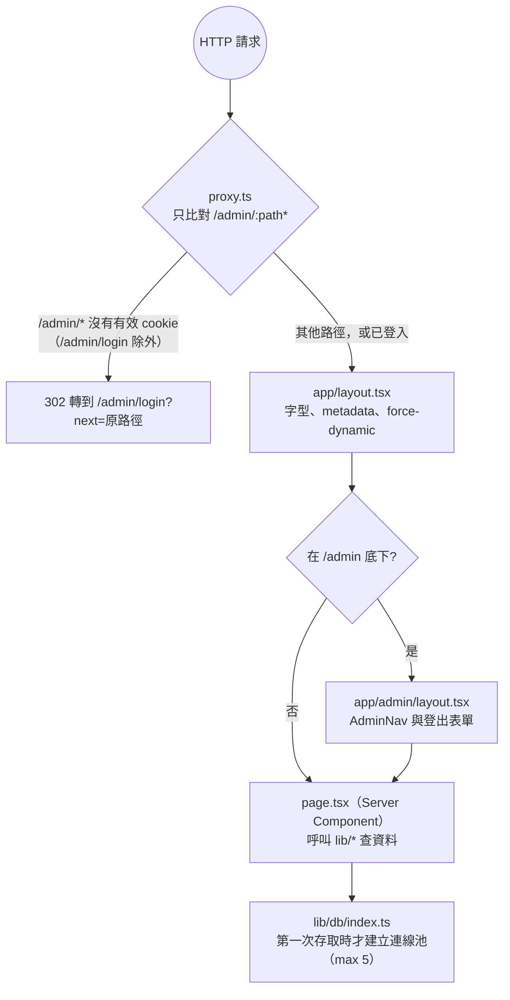
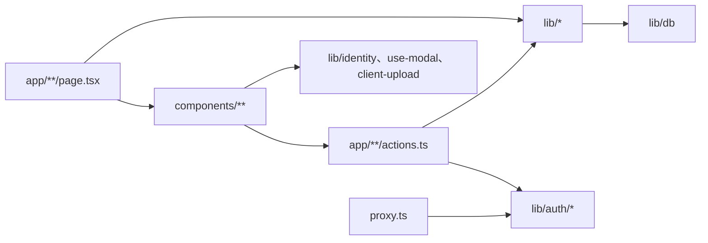
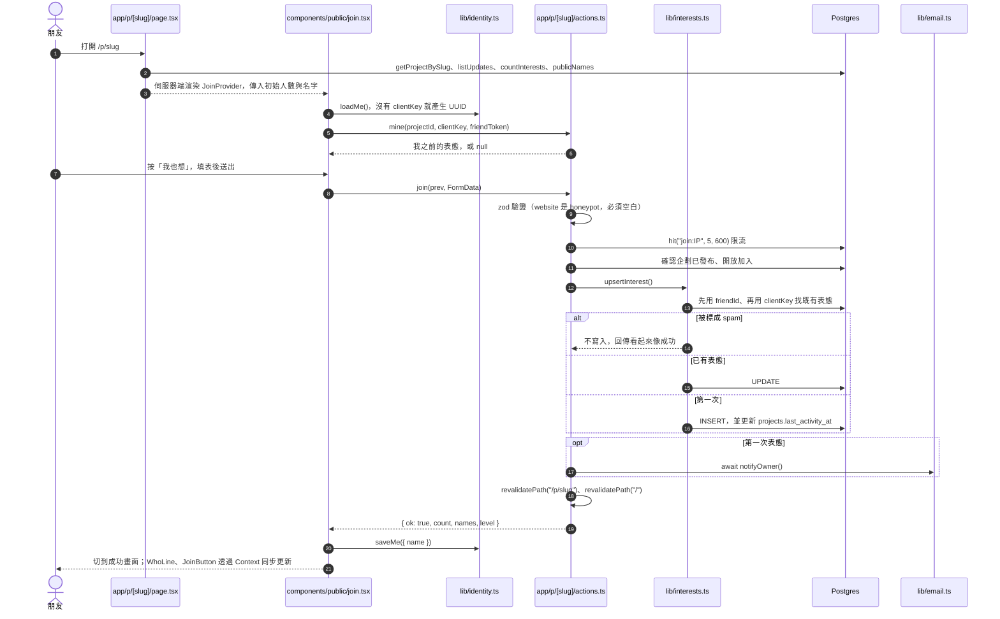
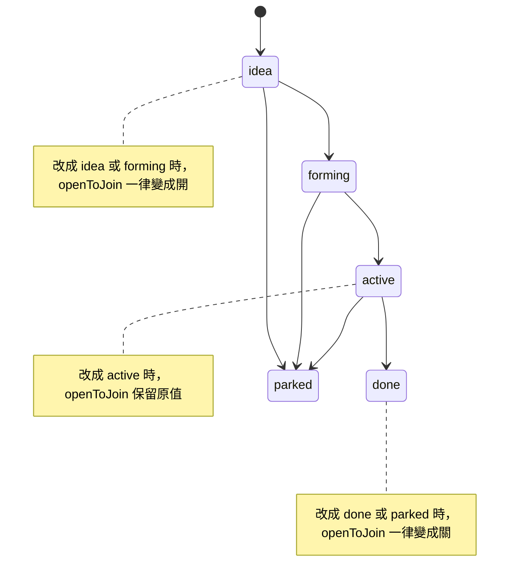

# 新進工程師知識文件

這份文件幫你接手維護這個專案。功能說明、環境變數、部署步驟、日常操作都已經寫在 [README](../README.md)，這裡不重複，只補 README 沒寫的架構、資料流、維護規範與風險。

## 0. 閱讀指南

**標示說明**

| 標示 | 意思 |
|---|---|
| **[確認]** | 有程式碼或設定佐證 |
| **[推論]** | 從程式碼或官方文件推得，需要實測 |
| **[待確認]** | 程式碼看不出來，要問原開發者 |

**建議順序**：先讀第 1、3、5 節了解全貌，要動手改之前再讀第 6、7 節。

> 本文件依 2026-10 的程式碼整理。程式碼與本文不一致時，以程式碼為準，並請更新本文。

---

## 1. 專案用途與技術棧

單一作者（小傑）的「想做清單」網站。小傑在後台發企劃，朋友不用帳號，在企劃頁按「我也想」表態，小傑收到 email 後私下聯絡。一起做完一件事，朋友的集章卡就多一章，每 5 章換一張「小傑券」。全站 `noindex`（`app/layout.tsx` 的 `robots`）。業務規則詳見 [README 功能總覽](../README.md#功能總覽)。

**技術棧**（版本以 `node_modules` 實際安裝的為準）

| 類別 | 套件 | 用途 |
|---|---|---|
| 框架 | next 16.3.8 | App Router、Server Actions、Turbopack |
| UI | react / react-dom 19.2.8 | 純 CSS，樣式全在 `app/globals.css` |
| 語言 | typescript 5.9.3 | `strict: true`，路徑別名 `@/*` |
| 資料庫 | drizzle-orm 0.45.3、postgres 3.4.9 | PostgreSQL |
| Migration | drizzle-kit 0.31.11 | 加上 `scripts/migrate.mjs` |
| 驗證 | jose 6 | 後台 HS256 JWT cookie |
| 表單驗證 | zod 4 | 只用在表態與企劃表單 |
| 圖片 | sharp、@aws-sdk/client-s3 | 轉 WebP，存到 Cloudflare R2 或本機 |
| ID | nanoid 6 | slug 與 token（`lib/slug.ts`） |
| Email | Resend HTTP API | 直接 `fetch`，沒有用 SDK（`lib/email.ts`） |
| 測試 | Node 內建 `node:test`，用 tsx 執行 | |

**沒有使用的東西**（避免誤會）：UI 套件、狀態管理套件、ESLint、Prettier、Git hooks、CI、廣告或網站分析碼。

> ⚠️ 這版 Next 跟一般熟悉的版本有破壞性差異，改程式前先讀 `node_modules/next/dist/docs/`（見 `AGENTS.md`）。本專案用到的差異：
> - 用 `proxy.ts` 取代 `middleware.ts`。
> - `params`、`searchParams` 要 `await`。
> - 使用全域型別 `PageProps<"/p/[slug]">`、`LayoutProps<"/admin">`、`RouteContext<"/uploads/[...file]">`。

---

## 2. 主要目錄與重要檔案

```
app/                     路由。每個功能目錄都是「page.tsx 讀資料 + actions.ts 寫資料」
  layout.tsx             根 layout：字型、metadata、全站 force-dynamic
  page.tsx               首頁
  p/[slug]/              企劃頁、表態 actions、OG 圖
  card/[token]/          朋友的集章卡、兌換 action
  about/                 關於頁（內容存在 settings 表）
  admin/                 後台：login/ projects/ friends/ rewards/ categories/ about/
  api/upload/route.ts    唯一的 REST 端點：圖片上傳
  uploads/[...file]/     本機儲存模式下回傳圖片
  error.tsx global-error.tsx not-found.tsx admin/error.tsx
components/
  public/                前台元件
  admin/                 後台元件
  card/                  集章卡互動
lib/                     商業邏輯與資料存取
  db/schema.ts           資料表定義，所有型別的來源
  db/index.ts            延遲建立連線的 db
  auth/                  session 與 requireAdmin
drizzle/                 SQL migration 與 meta 快照
scripts/migrate.mjs      套用 migration
proxy.ts                 擋未登入者進 /admin
vercel.json              Vercel build 指令
```

**最重要的 10 個檔案**

| 檔案 | 為什麼重要 |
|---|---|
| `lib/db/schema.ts` | 10 張表、外鍵行為、所有資料型別 |
| `lib/labels.ts` | 企劃狀態、投入程度、人數顯示等常數。key 會存進資料庫 |
| `lib/coupons.ts` | 集章換券規則 `STAMPS_PER_COUPON` 與 `checkRedeem` |
| `proxy.ts` | 後台頁面的登入守門 |
| `lib/auth/session.ts` | JWT 簽發與驗證、密碼比對、cookie 設定 |
| `app/p/[slug]/page.tsx` | 前台主頁面，一般模式與做完後的回顧模式 |
| `components/public/join.tsx` | 「我也想」的完整互動，前台最複雜的元件 |
| `app/p/[slug]/actions.ts` | 表態、取消、查詢自己表態的 Server Actions |
| `lib/interests.ts` | 辨認是誰在表態、新增或更新表態 |
| `app/admin/projects/actions.ts` | 存企劃：驗證、發布規則、改狀態、自動蓋章 |

**被 git 忽略的本機產物**：`data/`（本機上傳的圖片）、`shots/`（截圖）、`.playwright-mcp/`（瀏覽器自動化的 log）。

---

## 3. 應用程式入口與系統架構

### 3.1 請求流程



**初始化的重點** [確認]

- 沒有集中的設定模組。環境變數散在各模組直接讀 `process.env`，缺少時要等第一次用到才拋錯，例如 `lib/auth/session.ts` 的 `secret()`、`lib/db/index.ts` 的 `real()`。
- `lib/db/index.ts` 的 `db` 是 Proxy，import 時不會連資料庫，所以 `next build` 不需要資料庫。連線存在 `globalThis.idea_db`，避免 dev 熱重載時重複建立。
- `lib/uploads.ts` 在模組載入時就依環境變數決定用 R2 還是本機硬碟。
- 根 layout 設了 `dynamic = "force-dynamic"`，全站每次請求都直接查資料庫，不靠快取。

### 3.2 分層

| 層 | 位置 | 職責 |
|---|---|---|
| 頁面 | `app/**/page.tsx` | Server Component，讀資料、組畫面 |
| 寫入 | `app/**/actions.ts` | Server Actions，驗證輸入、檢查權限、呼叫 lib、`revalidatePath` |
| 商業邏輯 | `lib/*.ts` | 資料存取與規則 |
| 互動元件 | `components/**`、少數 `app/**/*-form.tsx` | 加 `"use client"` 的元件 |
| REST | `app/api/upload/route.ts` | 唯一的 REST 端點，只有上傳圖片用 |

[確認] 有幾處繞過 `lib/` 直接查資料庫：`app/admin/page.tsx`、`app/admin/projects/[id]/page.tsx`、`app/admin/rewards/actions.ts`，以及 `app/admin/projects/actions.ts` 的 `deleteProject`。

### 3.3 狀態管理

沒有狀態管理套件。資料共享分四層：

| 層 | 機制 | 位置 |
|---|---|---|
| 伺服器資料 | 每次請求查資料庫；寫入後呼叫 `revalidatePath`，讓 action 的回應帶回新畫面 | 各 `page.tsx`、`actions.ts` |
| 表單狀態 | `useActionState` | `join.tsx`、`card-client.tsx`、`project-form.tsx`、`login-form.tsx`、`about-form.tsx` |
| 單頁共享 | React Context `JoinCtx` | `components/public/join.tsx` |
| 瀏覽器身份 | localStorage 的 `idea.me`：`{ clientKey, name, friendToken }` | `lib/identity.ts` |

### 3.4 權限與身份

- **後台**：單一密碼登入，成功後發 30 天的 JWT cookie `idea_admin`。驗證分三處：
  - `proxy.ts`：擋 `/admin/*` 頁面。
  - `lib/auth/require.ts` 的 `requireAdmin()`：每個後台 Server Action 開頭呼叫，因為 proxy 擋不到 Server Action。
  - `app/api/upload/route.ts`：自己檢查 cookie，失敗回 401 JSON。
- **前台**：朋友沒有登入，身份來自 localStorage 的 `clientKey`（UUID），或集章卡的 `friendToken`（22 字元）。打開集章卡時，`components/card/card-client.tsx` 的 `CardIdentity` 會把 `friendToken` 存進 localStorage。拿到這兩個值的人就被當成那位朋友。

### 3.5 錯誤處理

| 情況 | 做法 |
|---|---|
| 可預期的錯誤 | action 回傳 `{ ok: false, message }`，元件用 `role="alert"` 顯示紅字 |
| 找不到資料 | 呼叫 `notFound()`，顯示 `app/not-found.tsx`。未發布的企劃也當成找不到 |
| 後台的意外錯誤 | 拋出例外，由 `app/admin/error.tsx` 顯示 |
| 前台的意外錯誤 | 由 `app/error.tsx` 顯示；根 layout 出錯時由 `app/global-error.tsx` 顯示 |
| 寄信失敗 | 只印 `console.error`，不中斷主流程（`lib/email.ts`） |

### 3.6 模組依賴



[確認] 沒有循環依賴：`lib/` 從不 import `app/` 或 `components/`。但 `components/admin/*` 和 `components/public/join.tsx` 直接 import 特定的 `actions.ts`，所以這些元件無法拿到別處重用。

---

## 4. 本機啟動、測試、建置

完整步驟見 [README 本機開發](../README.md#本機開發)，摘要如下：

```bash
# Postgres 用 Docker 跑在 127.0.0.1:5440（指令見 README）
cp .env.example .env.local        # 填入必要變數
npm install
set -a && . ./.env.local && set +a && npm run db:migrate   # migrate 不會自動讀 .env.local
npm run dev
```

| 指令 | 說明 |
|---|---|
| `npm run dev` | 開發伺服器 |
| `npm test` | 執行 `tsx --test lib/*.test.ts`，目前 15 個測試 |
| `npm run typecheck` | `tsc --noEmit`。因為 `incremental: true`，會改寫 `tsconfig.tsbuildinfo` |
| `npm run build` | 正式版 build，會寫入 `.next/` |
| `npm start` | 先跑 migration 再 `next start`，給自架主機用 |
| `npm run db:generate` | 依 `lib/db/schema.ts` 產生 migration |
| `npm run db:migrate` | 套用 migration |

**README 沒寫或已過時的地方**

- [確認] README「已知限制」說「沒有自動化測試」，已經過時，現在有 `npm test`。
- [確認] 測試的 glob 只找 `lib/` 第一層的 `*.test.ts`。放在 `lib/auth/` 或 `components/` 底下的測試不會被執行。
- [推論] `next build` 不需要資料庫，但 `next/font/google` 要在 build 時下載字型，離線可能無法 build。
- [確認] 本機連續表態 5 次、或登入失敗 5 次，會被擋 10 分鐘。計數存在資料庫的 `rate_limits` 表，重啟伺服器不會清掉。

**環境變數**（只列名稱，值請向團隊索取，不要 commit）

| 變數 | 必填 | 缺少時 |
|---|---|---|
| `DATABASE_URL` | 是 | 幾乎每一頁都打不開，連首頁也是 |
| `ADMIN_PASSWORD` | 是 | 無法登入後台 |
| `SESSION_SECRET` | 是（至少 32 字元） | 後台一直被導回登入頁 |
| `SITE_URL` | 是 | 通知信、OG 圖的網址錯誤 |
| `RESEND_API_KEY`、`NOTIFY_EMAIL`、`FROM_EMAIL` | 否 | 不寄信，通知內容只印在伺服器 log（找 `[notify]`） |
| `R2_ACCOUNT_ID`、`R2_ACCESS_KEY_ID`、`R2_SECRET_ACCESS_KEY`、`R2_BUCKET`、`R2_PUBLIC_URL` | 否（正式環境必填） | 缺任何一個就改存本機 `data/uploads` |
| `UPLOAD_DIR` | 否 | 本機圖片目錄，預設 `./data/uploads` |
| `SITE_OWNER` | — | [待確認] 寫在 `.env.example`，但程式碼裡沒有使用處 |

**部署流程** [確認]

```
git push → Vercel 執行 vercel.json 的 buildCommand：
  node scripts/migrate.mjs   （VERCEL_ENV 不是 production 就跳過）
  && next build
```

- migration 在 build **之前**對正式資料庫執行。build 失敗時，資料庫已經是新結構，線上仍跑舊程式。
- Preview 部署會跳過 migration，但執行時仍會連 `DATABASE_URL`。設定方式見 [README Preview 部署](../README.md#preview-部署)。
- [推論] repo 裡沒有 CI 設定，推測是靠 Vercel 的 Git 整合自動部署。

---

## 5. 核心功能與端到端資料流

### 5.1 我也想表態

最核心的流程，涵蓋了伺服器端渲染、Context、localStorage 身份、驗證、限流、寄信與 UI 更新。



**細節** [確認]

- `JoinButton`、`WhoLine` 在頁面上各出現兩次（手機版與桌機側欄），透過 `useJoin()` 共用同一份狀態。
- 頁面上的按鈕捲出畫面後，底部 sticky 列才出現。由 `join.tsx` 的 `IntersectionObserver` 監看 `[data-cta]` 控制。
- bottom sheet 的鎖捲動、Esc 關閉、背景 `inert`、焦點移入與還原，都由 `lib/use-modal.ts` 的 `useModal` 處理。
- 取消表態是軟刪除，設定 `interests.cancelled_at`（`lib/interests.ts` 的 `cancelMine`）。
- 狀態是 `done` 的企劃頁改成回顧模式，不渲染 `JoinProvider`。

### 5.2 後台存企劃

```
components/admin/project-form.tsx  submitWith(intent)
  → app/admin/projects/actions.ts  saveProject(id, prev, formData)
      requireAdmin()
      read() 用 zod 驗證（人數用 sizeMode 判別聯合）
      檢查分類是否存在；要發布時檢查 publishProblem()（一句話必填）
      新增：createProject() → 狀態不是 idea 時再 setStatus()
      編輯：updateProject() → 狀態有變時 setStatus()
            → 狀態是 done 時 stampForProject() 幫勾選的朋友蓋章
      revalidatePath(...)
```

- `project-form.tsx` 刻意不用 `<form action>`，改成自己組 `FormData` 再 `dispatch`。原因寫在註解裡：React 會在 action 結束後重設表單，存檔失敗時剛打的字會不見。
- 「刪除」按鈕用自己的 `formAction` 加上 `data-delete` 標記，繞過 `onSubmit`。
- `lib/projects.ts` 的 `setStatus` 每次改狀態都會寫一筆 `kind: "system"` 的更新紀錄，並調整 `openToJoin`。



[確認] 圖上是 README 描述的一般流程，但程式碼沒有限制轉換方向，後台可以從任何狀態改成任何狀態。

### 5.3 集章與兌換

```
app/card/[token]/page.tsx  CardPage
  → lib/friends.ts friendCard()：查章、兌換紀錄、啟用中的券菜單；用 couponSummary() 算出解鎖幾張券
  → components/card/card-client.tsx
      CardIdentity：saveMe({ name, friendToken })，之後表態會自動綁定這位朋友
      Coupons：選項目後送出
  → app/card/[token]/actions.ts  redeem()
      checkRedeem()：券要已解鎖、還沒換過
      requestRedemption()：INSERT ... ON CONFLICT DO NOTHING
      notifyOwner()
```

[確認] 防止同一張券換兩次靠的是資料庫唯一索引 `redemptions (friend_id, coupon_index)`，同時送兩次也只會成功一次。

### 5.4 圖片上傳

```
lib/client-upload.ts uploadImage()：瀏覽器縮到 1600px、轉 JPEG（瀏覽器無法解碼時傳原檔）
  → POST /api/upload（app/api/upload/route.ts，檢查 cookie）
  → lib/uploads.ts saveImage()：檢查類型與大小 → sharp 轉 WebP → 存 R2 或本機
  → 回傳 { url }，存進表單的隱藏欄位
```

---

## 6. 開發規範與常見注意事項

### 6.1 既有慣例

這些慣例沒有寫成文件，也沒有工具強制，是從程式碼歸納出來的。新程式碼請照著寫。

| 面向 | 慣例 |
|---|---|
| 檔名 | kebab-case，例如 `project-form.tsx`、`rate-limit.ts` |
| 元件 | named export、PascalCase；只有 Next 規定的檔案（page、layout、error）用 default export |
| lib 函式 | 動詞開頭：`list*`、`get*`、`create*`、`update*`、`delete*`、`set*` |
| 資料夾 | `page.tsx` 讀、同目錄 `actions.ts` 寫；只給某頁用的表單放在該路由目錄 |
| 元件分組 | 依使用者分成 `public`、`admin`、`card`，不依元件類型分 |
| 格式 | 2 空白縮排、雙引號、有分號 |
| 樣式 | 共用樣式寫在 `app/globals.css`，顏色用開頭的 CSS 變數；個別調整常用 inline style |
| 註解 | 少量；業務規則用中文，技術細節用英文；寫「為什麼」而不是「做什麼」 |
| UI 文字 | 繁體中文、口語，直接寫在元件裡 |
| 型別 | 從 `lib/db/schema.ts` 推導；action 回傳判別聯合型別；client 元件只 `import type` |
| commit | 中文訊息，列出這次改了哪些項目 |

### 6.2 容易踩到的地方

| 注意事項 | 位置 |
|---|---|
| 新增後台 Server Action，開頭一定要 `await requireAdmin()`。proxy 擋不到 Server Action | `app/admin/*/actions.ts` |
| 新增公開 Server Action，要用 zod 驗證，視需要用 `hit()` 限流，並確認企劃已發布 | 參考 `app/p/[slug]/actions.ts` 的 `join` |
| 「有效表態」（未取消且不是 spam）的條件寫在兩處，要一起改，否則首頁和企劃頁人數會不同 | `lib/projects.ts` 的 `countExpr`、`lib/interests.ts` 的 `active()` |
| `STAMPS_PER_COUPON` 改了，已兌換紀錄的 `coupon_index` 會對應到不同章數 | `lib/coupons.ts` |
| `EFFORT` 的 key 存在資料庫。改了不會有型別錯誤，舊資料只會顯示成空白 | `lib/labels.ts` |
| localStorage key `idea.me` 改名，所有朋友的身份都會重設 | `lib/identity.ts` |
| 上傳網址格式有四處必須一致 | `lib/uploads.ts` 的 key 與 `isUploadUrl`、`app/uploads/[...file]/route.ts` 的正規表示式、`app/admin/projects/actions.ts` 的 `parsePhotos` |
| migration 必須能讓舊程式繼續運作，因為它在 build 前就對正式資料庫執行。`drizzle-kit generate` 不會自動轉換舊資料，`0003`、`0005` 都是手動補的 | `drizzle/*.sql`、`lib/db/schema.ts` 的 `idealSize` 註解 |
| `project-form.tsx` 自己送出表單，不要改回 `<form action>` | `components/admin/project-form.tsx` 的 `submitWith` |
| `useModal` 把 sheet 以外的元素設成 `inert`，但會跳過 `.backdrop`；改 DOM 結構或類名要注意 | `lib/use-modal.ts` |
| 新的寫入要讓哪些頁面更新，照既有寫法列出 `revalidatePath(...)` | 各 `actions.ts` |
| 程式碼裡有 `eslint-disable` 註解，但專案沒有安裝 ESLint，這些註解目前沒有作用 | `app/p/[slug]/page.tsx` 等 6 個檔案 |
| 新增環境變數，要同步更新 `.env.example` 和 README | |

---

## 7. 修改功能前的檢查清單

### A. 修改前要讀

- [ ] README 中跟這個功能相關的段落
- [ ] `lib/db/schema.ts`：會碰到的表、欄位、外鍵的 `onDelete`
- [ ] `lib/labels.ts`、`lib/coupons.ts`：會碰到的常數
- [ ] 該功能的 `page.tsx`、`actions.ts`、呼叫到的 `lib/*.ts`、對應的元件
- [ ] 改到 Next API 時，讀 `node_modules/next/dist/docs/` 相關章節
- [ ] `git log -p -- <檔案>`：看之前為什麼這樣改

### B. 確認相依功能

- [ ] 用 `git grep` 找出函式、常數、類名的所有使用處，包括 `app/admin/*` 直接查資料庫的地方
- [ ] 改 schema：產生 migration 並打開 SQL 檢查；舊程式在新結構上能不能跑；舊資料要不要轉換
- [ ] 改常數的 key 或數值：資料庫裡的既有資料會怎麼顯示
- [ ] 對照第 6.2 節，確認沒有碰到「必須一起改」的地方

### C. 執行檢查

- [ ] `npm run typecheck`
- [ ] `npm test`；改了純函式就在 `lib/` 第一層補測試
- [ ] `npm run build`
- [ ] 改了 schema：在乾淨的本機資料庫跑 `npm run db:migrate`，再對正式資料的備份（`pg_dump`）跑一次
- [ ] `git diff` 只包含預期的改動

### D. 手動回歸

依修改範圍，在 `npm run dev` 下走一遍：

- [ ] 首頁：分類篩選 `?c=`；正在發生、想做的事、一起做過的三區分組正確
- [ ] 企劃頁：一般模式、回顧模式；未發布的企劃顯示 404
- [ ] 我也想：第一次表態、修改、取消；人數與公開名字正確；伺服器 log 有 `[notify]`
- [ ] 換一個瀏覽器先開集章卡再表態，後台應顯示「有集章卡」
- [ ] 後台：未登入被導到登入頁；存草稿、發布、取消發布；改狀態後多一則更新紀錄；改成 done 並勾選朋友後蓋章，再存一次不會重複蓋
- [ ] 集章卡：滿 5 章出現一張券；兌換後顯示「等小傑來約」；後台待辦出現；標記兌現後券變成灰色
- [ ] 圖片：封面、回顧照片、更新附圖都能上傳並在前台顯示
- [ ] 手機寬度（小於 768px）：sticky 列、bottom sheet 開關、焦點移動
- [ ] 桌機寬度（960px 以上）：右側摘要卡、置中視窗
- [ ] 部署後：照 [README 部署後檢查](../README.md#部署後檢查) 逐項確認

---

## 8. 風險與待確認問題

### 8.1 已確認的風險

| 風險 | 位置 | 影響 |
|---|---|---|
| 刪除已被兌換過的券菜單項目會失敗 | `app/admin/rewards/actions.ts` 的 `removeReward`；外鍵 `ON DELETE no action`（`drizzle/0000_dapper_black_widow.sql`） | 後台跳到錯誤畫面。可改用「停用」代替刪除 |
| 多步驟寫入沒有包 transaction | `lib/projects.ts` 的 `createProject`、`setStatus`；`app/admin/projects/actions.ts` 的 `saveProject` | 中途失敗時資料只寫了一半 |
| 自動蓋章可能重複 | `lib/friends.ts` 的 `stampForProject` 先查再寫，`stamps` 沒有 `(friend_id, project_id)` 唯一索引 | 同時送出兩次可能重複蓋章 |
| 更換 `R2_PUBLIC_URL` 後，舊的回顧照片會在下次存企劃時被默默刪掉 | `parsePhotos` 只保留符合 `isUploadUrl()` 的網址；`coverUrl` 則完全沒有過濾 | 照片資料遺失 |
| migration 在 build 前執行 | `vercel.json` | build 失敗時，資料庫與線上程式版本不一致 |
| 前台與後台的更新紀錄接行方式不同 | 前台 `app/p/[slug]/page.tsx` 的 `Timeline` 用空白接，後台 `components/admin/updates-panel.tsx` 用換行接 | 兩邊顯示不一致 |
| 部分公開 action 沒有限流 | `app/p/[slug]/actions.ts` 的 `cancel`、`mine`；`app/card/[token]/actions.ts` 的 `redeem` | 每位訪客打開企劃頁都會呼叫一次 `mine` |
| 取消表態失敗時沒有提示 | `components/public/join.tsx` 的 `doCancel` | 使用者不知道沒取消成功 |
| 刪除朋友後，他的表態仍保留，但不再綁定朋友 | `interests.friend_id` 是 `ON DELETE set null` | 後台看到沒有集章卡的表態 |
| 品質檢查很少 | 沒有 CI、ESLint、Git hooks、E2E；以前用過的 Playwright 腳本沒有留在 repo | 修改後主要靠手動驗證 |
| 資料存取沒有完全集中在 `lib/` | 見第 3.2 節 | 修改規則時容易漏改 |
| 重複的程式 | 用 token 找朋友：`lib/interests.ts` 的 `friendByToken` 與 `lib/friends.ts` 的 `getFriendByToken`；session 檢查寫在三處 | 修改時容易漏改 |

### 8.2 推論，需要實測

| 推論 | 依據 |
|---|---|
| production 上 `app/admin/error.tsx` 的「登入過期了」分支可能永遠不會出現，使用者只會看到通用錯誤訊息 | 該檔用 `error.message === "unauthorized"` 判斷；Next 官方文件 `node_modules/next/dist/docs/01-app/03-api-reference/03-file-conventions/error.md` 說明 production 會把伺服器傳來的錯誤訊息換成通用訊息 |
| 自架主機時，限流可以被繞過 | `lib/rate-limit.ts` 的 `clientIp()` 直接信任 `x-forwarded-for` 的第一個值。在 Vercel 上由平台設定，應該可靠 |
| Resend 變慢時，表態與兌換也會跟著變慢 | `join()`、`redeem()` 都 `await notifyOwner()` |
| 離線時無法 build | `next/font/google` 在 build 時下載字型 |

### 8.3 待原開發者確認

1. `SITE_OWNER` 是預留還是已經廢棄？
2. `STAMPS_PER_COUPON` 以前是其他數字嗎？若是，舊的兌換紀錄對應的章數範圍已經改變。
3. 資料存取散在 `lib/` 與 `app/admin/*`，是刻意保持簡單，還是打算收斂到 `lib/`？
4. 是否打算加入 CI（至少跑 typecheck、test、build）與 ESLint？
5. 以前的 Playwright 腳本（`card.mjs`、`sticky.mjs`、`admin.mjs`、`showcase.mjs`）還在嗎？要不要放進 repo？
6. 前台更新紀錄用空白接行、後台用換行，哪一個是預期的？
7. 取消表態失敗時沒有提示，是刻意的嗎？
8. 正式環境實際部署在 Vercel 還是其他主機？這會決定第 8.2 節的限流風險是否存在。
